# 🔬 Machine Learning & Deep Learning Pipeline Specifications

This document defines the mathematical foundations, data preprocessing, architectures, training objectives, evaluation metrics, and explainability mechanisms for the AI Crop platform.

---

## 1. Multi-Modal ML Model Matrix

```mermaid
graph TD
    subgraph Vision ["Computer Vision (Pathology)"]
        V1["Leaf Image (224x224x3)"] --> V2["MobileNetV3-Small Backbone"]
        V2 --> V3["Feature Maps"]
        V3 --> V4["Classifier (38 Classes)"]
        V3 --> V5["Grad-CAM Gradient Engine"]
        V5 --> V6["Visual Heatmap Base64"]
    end

    subgraph Tabular ["Tabular ML (Yield & Crop)"]
        T1["Soil & Climate Features (N, P, K, pH, Rain, Temp)"]
        T1 --> T2["LightGBM Yield Regressor"]
        T1 --> T3["Random Forest Crop Classifier"]
        T2 --> T4["Yield (Quintals/Acre)"]
        T2 --> T5["SHAP TreeExplainer"]
        T5 --> T6["Feature Attribution Waterfall"]
    end

    subgraph Econometrics ["Time-Series (Mandi Prices)"]
        E1["Daily APMC Modal Prices"] --> E2["Prophet / SARIMA"]
        E2 --> E3["30-Day Price Forecast & Trend"]
    end
```

---

## 2. Model 1: Plant Leaf Pathology Classification (Computer Vision)

### 2.1 Problem Formulation
Multi-class image classification task over $C = 38$ distinct crop-disease pairs (e.g., *Tomato Early Blight, Potato Late Blight, Wheat Yellow Rust, Apple Scab, Healthy Maize*).

### 2.2 Model Architecture & Transfer Learning
* **Backbone**: `MobileNetV3-Small` pre-trained on ImageNet-1k.
* **Inverted Residual Blocks**: Hard-Swish activation $\text{H-Swish}(x) = x \cdot \frac{\text{ReLU6}(x + 3)}{6}$ and Squeeze-and-Excitation (SE) attention modules.
* **Classification Head**:
  $$\text{Dropout}(p=0.3) \longrightarrow \text{Linear}(d_{\text{embed}}, 256) \longrightarrow \text{ReLU}() \longrightarrow \text{Linear}(256, 38)$$

### 2.3 Loss Function & Optimization
* **Loss Function**: Label-Smoothed Cross-Entropy Loss ($\epsilon = 0.1$):
  $$\mathcal{L}_{\text{CE}} = - \sum_{i=1}^{C} \left( (1 - \epsilon) y_i + \frac{\epsilon}{C} \right) \log p_i$$
* **Optimizer**: AdamW ($\beta_1=0.9, \beta_2=0.999$, weight decay $\lambda = 10^{-4}$, initial learning rate $\eta = 5 \times 10^{-4}$) with Cosine Annealing Learning Rate Schedule.

### 2.4 Explainable AI: Grad-CAM (Gradient-Weighted Class Activation Mapping)
Grad-CAM computes the gradient of the score for target class $c$ ($y^c$) with respect to feature activation map $A^k$ of the last convolutional layer:
$$\alpha_k^c = \frac{1}{Z} \sum_{i} \sum_{j} \frac{\partial y^c}{\partial A_{i, j}^k}$$
The class-discriminative localization map $L_{\text{Grad-CAM}}^c$ is computed as:
$$L_{\text{Grad-CAM}}^c = \text{ReLU}\left( \sum_{k} \alpha_k^c A^k \right)$$
The resulting heatmap is normalized $[0, 255]$, color-mapped via JET/Viridis, and blended with the original leaf photo at $40\%$ opacity.

---

## 3. Model 2: Crop Yield Prediction Engine (Tabular Regression)

### 3.1 Problem Formulation
Predict expected crop harvest yield $Y \in \mathbb{R}^+$ (measured in **Quintals per Acre** / Metric Tonnes per Hectare) given regional soil fertility, climatic variables, and farm management parameters.

### 3.2 Input Feature Vector $\mathbf{x}$
$$\mathbf{x} = \left[ \text{Crop\_ID}, \text{Season}, \text{State}, \text{Area (Acres)}, N, P, K, \text{pH}, \text{Rainfall (mm)}, \text{Temp\_Avg (}^\circ\text{C)}, \text{Humidity (\%)} \right]$$

### 3.3 Model Architecture: LightGBM / XGBoost Regressor
* Gradient Boosted Decision Trees (GBDT) using histogram-based algorithms for fast training and robust handling of non-linear feature interactions.
* **Hyperparameters**:
  * `n_estimators`: 250
  * `learning_rate`: 0.05
  * `max_depth`: 6
  * `num_leaves`: 31
  * `colsample_bytree`: 0.8
  * `subsample`: 0.8

### 3.4 Evaluation Metrics
* **Coefficient of Determination ($R^2$)**:
  $$R^2 = 1 - \frac{\sum_{i=1}^n (y_i - \hat{y}_i)^2}{\sum_{i=1}^n (y_i - \bar{y})^2} \ge 0.90$$
* **Mean Absolute Error (MAE)**:
  $$\text{MAE} = \frac{1}{n} \sum_{i=1}^n |y_i - \hat{y}_i| \le 1.20\text{ Qtl/Acre}$$
* **Root Mean Squared Error (RMSE)**:
  $$\text{RMSE} = \sqrt{\frac{1}{n} \sum_{i=1}^n (y_i - \hat{y}_i)^2}$$

### 3.5 Explainable AI: SHAP (SHapley Additive exPlanations)
Using **TreeSHAP**, the model output $f(\mathbf{x})$ is decomposed into an additive attribution of each feature's contribution relative to the expected base value $\mathbb{E}[f(X)]$:
$$f(\mathbf{x}) = \phi_0 + \sum_{j=1}^{M} \phi_j(\mathbf{x})$$
* Each $\phi_j$ represents the marginal increase or decrease in estimated yield contributed by feature $j$ (e.g., *"High Nitrogen (+35kg/ha) added +2.1 Quintals/Acre, while Low Rainfall deficit subtracted -1.4 Quintals/Acre"*).

---

## 4. Model 3: Crop Recommendation Classifier

### 4.1 Problem Formulation
Multi-class classification recommending the optimal crop choice out of 22 staple and commercial Indian crops based on agro-ecological parameters.

### 4.2 Algorithm & Ensemble Strategy
* **Primary Classifier**: Stratified Random Forest ($100$ estimators, Gini impurity criterion).
* **Secondary Classifier**: LightGBM Classifier with soft-voting ensemble.
* **Output**: Top-$K$ ranked crops with calibrated class probabilities:
  $$P(\text{Crop}_k \mid \mathbf{x}) = \frac{\exp(z_k)}{\sum_{j=1}^K \exp(z_j)}$$

---

## 5. Model 4: APMC Mandi Commodity Price Forecaster

### 5.1 Formulation
Decompose historical daily mandi wholesale prices $y(t)$ into trend, seasonal, and event components:
$$y(t) = g(t) + s(t) + h(t) + \epsilon_t$$
where:
* $g(t)$: Non-periodic piecewise linear growth trend.
* $s(t)$: Periodic weekly and annual crop harvest seasonality.
* $h(t)$: Holiday / festival demand shock impacts (e.g., Diwali, Pongal, Baisakhi).
* $\epsilon_t$: Residual error term.

### 5.2 Business Decision Output
* **"Sell Now"**: When current spot price $> 1.05 \times \text{Forecast}_{30\text{d}}$.
* **"Hold / Store"**: When forecast shows expected price appreciation $\ge 6.5\%$ within 30 days exceeding storage cost.
